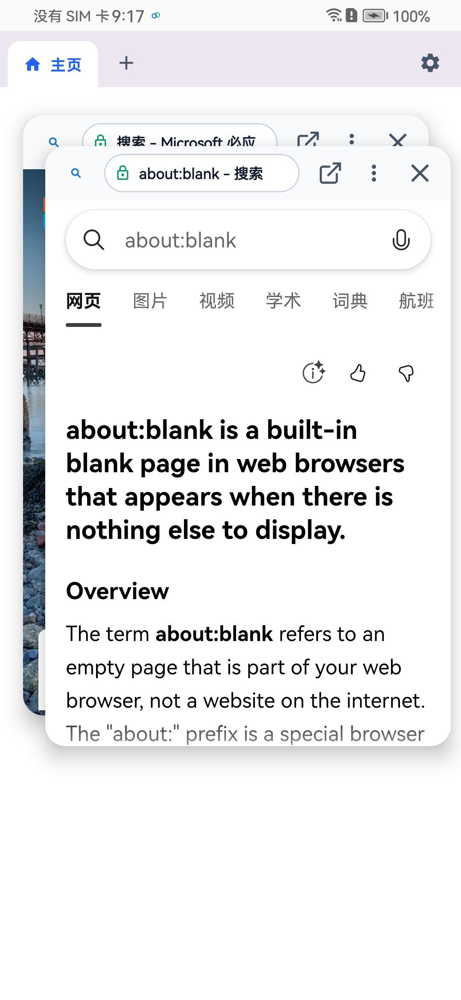

# FloatBro

> **现代 Android 原生全局悬浮、对等双视口分屏、纯 C++ 规则引擎拦截的高性能多任务浏览器**

[](https://github.com/gxwane/floatbro/releases)
[](https://github.com/gxwane/floatbro/actions)
[](https://www.gnu.org/licenses/gpl-3.0)
[](https://developer.android.com/about/versions/oreo)
[](https://developer.android.com)
[](https://kotlinlang.org)
[](https://developer.android.com/compose)
[](https://developer.android.com/guide/practices/page-sizes)

---

## 📸 界面预览 (Showcase)

| 🪟 全局独立悬浮 | ➗ 对称双视口分屏 | 🫧 贴边磁吸小气泡 |
| :---: | :---: | :---: |
|  |  |  |

---

## 📥 下载体验 (Download)

* 🚀 **[前往 GitHub Releases 下载最新安装包](https://github.com/gxwane/floatbro/releases)**
* 📦 **包体积**：约 2.6 MB（C++ 原生优化，极致轻量）
* 🛡️ **安全保证**：全面支持 Android 8.0 ~ Android 16，具备官方正式发布私钥签名，严格通过 Android 15 16KB Page Size 内存对齐检验。

---

## ✨ 核心特性 (Features)

1. **网页即浮窗（零主应用外壳包袱）**：
   - 基于 `SYSTEM_ALERT_WINDOW` 与前台服务，点击直接以独立系统顶层浮窗运行，无需受困于笨重的浏览器全屏外壳；
   - 右下角配备专属拖拽抓手（Resize Handle），手指触控自由缩放尺寸与纵横比；
   - 动态焦点桥接（InputFocusBridge）：网页表单与地址栏输入时精准唤起软键盘，失焦自动恢复底层宿主应用触控穿透。

2. **对等双视口真分屏（Symmetric Split-View）**：
   - 拒绝两个散装乱飘的拼图浮窗；双视口各自持有独立的标签页与前进/后退历史栈；
   - 内置 Windows 风格中线分割条，实时支持 15%~85% 比例动态分配，双击中线居中 50:50 复位；
   - 支持跨视口调度：主视口长按超链接可一键“在对侧视口打开”。

3. **原生 C++ 规则过滤引擎（Native Ad-Blocking）**：
   - 底层集成独立 C++ 算法引擎（`:adblock-client`），利用 BloomFilter 与哈希表实现亚毫秒级 URL 规则匹配；
   - 原生支持 Chromium CSS `:has()` 伪类与元素隐藏语法，精准剔除广告 DOM 节点与留白；
   - 内置安全规则脱敏机制，确保主流音视频站与内容站点正常加载渲染。

4. **空间物理手势与交互动效 (Spatial Physics & Gestures)**：
   - **贴边折叠**：向屏幕边缘拖动自动触发 200ms 减速平滑吸附，外推超出阈值自动折叠为 52dp 贴边磁吸气泡；
   - **秒级复原**：轻触边缘气泡，网页原地秒级展开复原；
   - **拖拽销毁**：向下拖拽触发屏幕底部高保真红色圆形靶心，命中释放彻底关闭浮窗与释放后台进程。

5. **现代 Material 3 与高刷适配 (Modern UI & 120Hz)**：
   - 彻底解耦黑白墨水屏限制，全面拥抱 Material 3 设计系统与全彩深浅色主题自适应；
   - 所有菜单与设置弹窗均基于内嵌 Compose 图层渲染，彻底规避后台悬浮窗环境下的 `BadTokenException` 崩溃；
   - 浏览历史记录全面接入 `StateFlow` 响应式数据流，浮窗关闭或跳转时主控中心即时秒级同步。

6. **Android 15/16 严苛标准对齐 (16KB Page Size Aligned)**：
   - 全架构（arm64-v8a、armeabi-v7a、x86、x86_64）编译参数强制注入 `-Wl,-z,max-page-size=16384`；
   - 严格通过 Google 官方 `alignment.sh` ELF 16KB 分页对齐验证，确保在 Android 15+ 新旗舰机型上高效运行。

---

## 💡 核心手势与操作指南 (Gestures Guide)

| 交互动作 | 操作手势 | 预期响应 |
| :--- | :--- | :--- |
| **自由缩放** | 按住窗口右下角三槽抓手拖动 | 实时无级改变窗口宽度与高度（受 0.45~2.20 纵横比安全保护） |
| **分屏重排** | 拖动双视口之间的垂直/水平中线 | 实时重新分配双视口宽度比例 (15% ~ 85%) |
| **分屏复位** | 双击分屏中线分割条 | 瞬间平滑恢复 50:50 对称等宽布局 |
| **贴边吸附** | 拖拽浮窗至屏幕左侧或右侧松手 | 窗口执行 200ms 减速贴靠动画并轻微震动反馈 |
| **折叠为气泡** | 拖拽浮窗向左/右外推超过 40% 宽度 | 自动收缩为 52dp 贴边圆形磁吸气泡 (Bubble) |
| **还原气泡** | 单击屏幕边缘的悬浮气泡 | 气泡原地展开还原为完整悬浮窗视口 |
| **拖拽关闭** | 按住顶栏向屏幕底部拖动 | 底部浮现红色垃圾桶靶心，命中释放后安全销毁并退出 |
| **视频全屏控制** | 网页 HTML5 视频进入全屏时 | 顶部自动浮现半透明居中胶囊（支持拖动窗口与一键退出），右下角缩放手柄常驻可用 |

---

## 🛠️ 从源码编译构建 (Building from Source)

### 1. 前置环境要求 (Prerequisites)
- **JDK**：17 (推荐 [Eclipse Temurin 17](https://adoptium.net/))
- **Android SDK**：CompileSdk 36, TargetSdk 36, MinSdk 26
- **Android NDK**：r27c (`27.2.12479018`)
- **CMake**：3.22.1+
- **Gradle**：8.14 (由项目自带的 `gradlew` 包装器自动管理)

### 2. 构建与测试命令 (Build Commands)
```bash
# 克隆代码仓库
git clone https://github.com/gxwane/floatbro.git
cd floatbro

# 运行全量纯 JVM 毫秒级单元测试套件
./gradlew testDebugUnitTest

# 编译 Debug 版 APK
./gradlew assembleDebug

# 产物输出路径: app/build/outputs/apk/debug/app-debug.apk
```

---

## 🏗️ 工程多模块架构 (Architecture)

FloatBro 采用清晰的无环单向依赖多模块架构：

```text
FloatBro/
├── app/                  # [应用宿主] FloatBrowserService 前台服务、FloatingWindowView、FloatingBubbleView、内嵌 Compose 浮层
├── core/
│   ├── webview/          # [视口核心] 对称双视口真分屏 (TwoPaneLayout)、EBWebView 内核封装、InputFocusBridge 焦点桥接
│   └── common/           # [通用基础] Material 3 主题令牌、DisplayUtils 边界测量、DataStore 配置中心
├── ad-filter/            # [规则调度] EasyList 解析、CSS :has 注入、网络拦截器 (Pure Kotlin)
├── adblock-client/       # [C++ 原生] BloomFilter 算法匹配、libadblock-client.so、16KB 分页对齐 (CMake)
├── docs/                 # [项目文档] 架构规约、设计技术规范、实机展示资源
└── gradle/
    └── libs.versions.toml # 依赖版本字典 (Version Catalog)
```

---

## 🤝 参与贡献 (Contributing)

欢迎任何形式的开源贡献！无论是提交缺陷报告、建议新特性，还是直接发起 Pull Request：
1. 报告 Bug 或提出建议，请前往 [GitHub Issues](https://github.com/gxwane/floatbro/issues)；
2. 提交代码变更前，请先确保本地 `./gradlew testDebugUnitTest` 测试通过；
3. 遵循现有的代码风格与 [Keep a Changelog](https://keepachangelog.com/zh-CN/1.0.0/) 变更记录规范。

---

## ⚖️ 开源协议与致敬基石 (License & Attribution)

FloatBro 是一个遵循 **[GNU General Public License v3.0 (GPL-3.0-or-later)](LICENSE)** 的自由开源软件。

本项目是在杰出的开源墨水屏浏览器项目 **[EinkBro](https://github.com/plateaukao/einkbro)**（原作者：**[Plateau Kao](https://github.com/plateaukao)**）的基础上深度演进重构而来。FloatBro 继承了 EinkBro 优秀的去广告内核设计思想与分屏雏形，并针对现代通用 Android 智能手机场景实现了全面升级与独立悬浮架构改造。

我们向原作者 **Plateau Kao** 以及 EinkBro 社区贡献者致以最崇高的敬意与感谢！

> **语源注记 (Naming Note)**：
> **FloatBro** 命名由 **Float**（系统级全局悬浮）与 **Browser**（继承自开源基石 EinkBro 中 Browser 之缩写 “bro”）组合而成，代表专注于系统全局悬浮形态的高性能移动浏览器。项目名称中 “bro” 仅代表浏览器 (Browser)，绝无“兄弟”之意。
>
> **免责声明**：FloatBro 是一个独立的衍生项目，由 FloatBro 开源社区独立维护，未经 EinkBro 原作者官方背书，亦不代表 EinkBro 官方立场。
