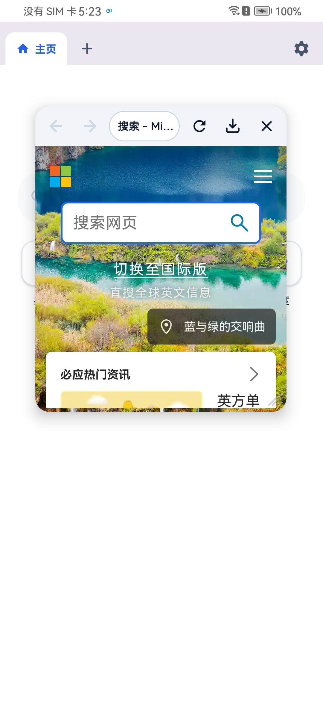

# FloatBro

[English](README_EN.md) | [简体中文](README.md)

> 现代轻量级 Android 全局网页悬浮多任务浏览器。

[](https://github.com/gxwane/floatbro/releases)
[](https://github.com/gxwane/floatbro/actions)
[](https://www.gnu.org/licenses/gpl-3.0)
[](https://developer.android.com/about/versions/oreo)
[](https://developer.android.com)

---

## 📸 界面预览

| 🪟 全局独立悬浮 | 🪟 多悬浮窗同屏 | 🫧 贴边磁吸气泡 |
| :---: | :---: | :---: |
|  |  |  |

---

## ✨ 核心特性

* **全局独立悬浮**：脱离常规浏览器全屏限制，以系统顶层浮窗伴随其他应用运行；主应用内长按标签页可直接撕下弹出为独立浮窗。
* **多悬浮窗同屏并存**：打破移动端单小窗限制，支持同屏多开独立网页悬浮窗，或在屏幕边缘挂载多个贴边气泡。
* **触控自由缩放**：拖动窗口右下角手柄，自由无级调整悬浮窗尺寸与长宽比。
* **贴边折叠与快速销毁**：悬浮窗推向屏幕边缘自动折叠为贴边气泡，点击即刻原地展开；向下拖动至屏幕底部靶心即可快速关闭。
* **网页视频全屏控制**：网页视频全屏播放时顶层常驻控制胶囊与缩放手柄，小窗下依然可自由拖拽与调整大小。
* **原生规则广告拦截**：集成 C++ 算法引擎，支持 EasyList 规则匹配与 CSS 元素隐藏，毫秒级过滤广告并移除占位。
* **现代 Material 3 设计**：主控中心支持多标签页与历史记录即时同步，深浅主题自适应，原生兼容 Android 15 16KB 分页内存标准。

---

## 💡 交互手势指南

| 交互操作 | 操作方式 | 响应效果 |
| :--- | :--- | :--- |
| **窗口缩放** | 拖动右下角手柄 | 自由调整悬浮窗尺寸与长宽比 |
| **贴边折叠** | 拖动浮窗推向屏幕边缘 | 自动收起为贴边气泡，释放屏幕空间 |
| **还原气泡** | 单击屏幕边缘的悬浮气泡 | 原地展开还原为悬浮窗 |
| **拖拽关闭** | 拖动浮窗向屏幕底部移动 | 移入底部关闭靶心释放即可退出 |
| **全屏视频控制** | 网页视频进入全屏时 | 顶部浮现居中控制胶囊，支持拖拽与退出全屏 |

---

## 📥 获取安装包

* 前往 **[GitHub Releases](https://github.com/gxwane/floatbro/releases)** 下载最新 APK 安装包。
* **系统要求**：Android 8.0 (API 26) 及更高版本（兼容 Android 15 与 Android 16）。

---

## 🛠️ 从源码编译

### 环境要求
* **JDK**：17
* **Android SDK**：CompileSdk 36, TargetSdk 36, MinSdk 26
* **Android NDK**：27.0.12077973 (r27)
* **CMake**：3.22.1+

### 构建命令
```bash
git clone https://github.com/gxwane/floatbro.git
cd floatbro

# 运行单元测试
./gradlew testDebugUnitTest

# 编译 Debug APK
./gradlew assembleDebug
# 输出路径: app/build/outputs/apk/debug/app-debug.apk
```

---

## 🏗️ 模块架构

```text
FloatBro/
├── app/                  # 应用宿主、LauncherActivity、FloatBrowserService、悬浮窗与气泡
├── core/
│   ├── webview/          # EBWebView 内核封装、软键盘焦点管理
│   └── common/           # Material 3 基础令牌、屏幕测量与配置持久化
├── ad-filter/            # EasyList 规则解析、CSS 注入与拦截器
├── adblock-client/       # C++ 规则匹配引擎 (libadblock-client.so)
└── docs/                 # 架构规约、设计技术规范与图片资源
```

---

## ⚖️ 开源协议与鸣谢

* **开源协议**：本项目基于 **[GNU General Public License v3.0 (GPL-3.0-or-later)](LICENSE)** 开源。
* **鸣谢**：FloatBro 的去广告内核源自开源墨水屏浏览器 **[EinkBro](https://github.com/plateaukao/einkbro)**。在此向原作者 **[Plateau Kao](https://github.com/plateaukao)** 及 EinkBro 社区的杰出工作致敬。
