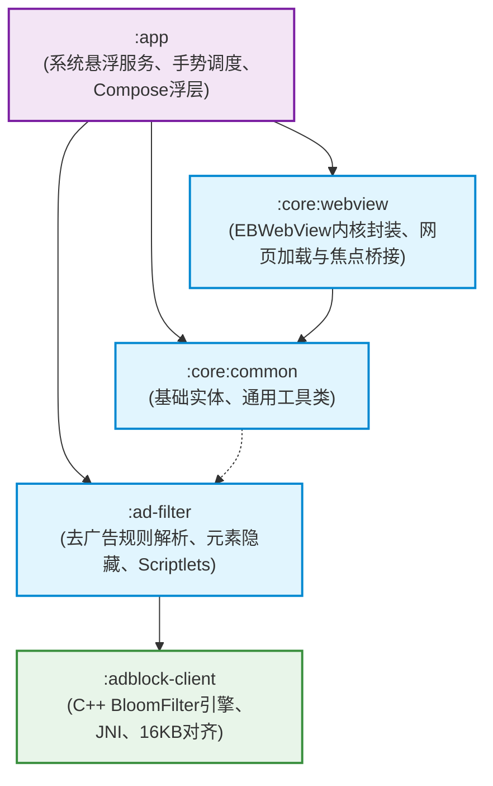

# FloatBro 系统架构契约与设计规约 (Architecture Specification)

本文档为 FloatBro 项目的核心系统架构契约。所有开发人员与项目贡献者 (Contributors) 必须严格遵循本文档所界定的模块拓扑、依赖流向与防腐边界。

---

## 一、 多模块工程拓扑图 (Module Topology & DAG)

FloatBro 采用现代 Android 多模块架构，严格遵循**无环依赖原则 (Acyclic Dependencies Principle, ADP)** 与单向由外向内的依赖倒置法则：

### 模块职责与边界规约

| 模块名称 | 语言与技术栈 | 职责范围与边界红线 |
| :--- | :--- | :--- |
| **`:adblock-client`** | C++17, CMake, NDK r27c, JNI | • 高性能 BloomFilter 与 Hash 规则匹配引擎； • 强制执行 Android 15 16KB Page Size 内存对齐； • **严禁依赖任何上层 Java/Kotlin 类**。 |
| **`:ad-filter`** | Pure Kotlin, OkHttp, Coroutines | • EasyList 规则下载、本地解析、持久化与规则匹配； • 注入 CSS `:has()` 选择器与反反爬 Scriptlets； • **纯 Kotlin 逻辑，零 Android View 强绑定**。 |
| **`:core:common`** | Kotlin | • 跨模块共享的数据实体、常量、扩展函数与工具类； • 纯净库，不持有任何 UI 或 WebView 逻辑。 |
| **`:core:webview`** | Kotlin, AndroidX WebKit | • 硬件加速 `EBWebView` 封装与 Chromium 内核调优； • `InputFocusBridge` DOM 表单聚焦监听桥接； • 基础视口容器与试验性 `TwoPaneLayout`。 |
| **`:app`** | Kotlin, Jetpack Compose, Material 3 | • `FloatBrowserService` (前台服务挂载 `TYPE_APPLICATION_OVERLAY`)； • `FloatingWindowView` (窗口主容器) 与 `FloatingBubbleView` (52dp 贴边磁吸气泡)； • 软键盘与底层穿透的动态焦点调度。 |

---

## 二、 全局元架构三铁律 (Meta-Architecture Invariants)

1. **依赖单向流动与严格无环 (The Dependency Rule & ADP)**：
   - 依赖关系只能由外层（`:app`）流向内层（`:core`）与基础设施（`:adblock-client`）。
   - 严禁模块间出现直接或间接的循环引用（例如 `:core:webview` 绝不得引用 `:app`）。
2. **悬浮窗防腐红线一：彻底根除 `BadTokenException`**：
   - 由于系统悬浮窗运行在后台 `Service` 环境，缺乏 Activity 级别的 `WindowToken`；
   - **严禁在悬浮窗内弹出任何系统级 Dialog (`AlertDialog`, `PopupMenu` 等)**；
   - 所有菜单、设置、书签界面必须通过内嵌的 `ComposeOverlayHost` 在当前悬浮窗自身的 View 视图树中完成局部渲染与状态切换。
3. **悬浮窗防腐红线二：根视图全树生命周期必须挂载**：
   - 在向 `WindowManager` 添加顶层根视图时，**必须在根视图 (`FloatingWindowView`) 上显式挂载 `OverlayLifecycleContext`**；
   - 使得 `ViewTreeLifecycleOwner`、`ViewTreeViewModelStoreOwner` 和 `ViewTreeSavedStateRegistryOwner` 从根节点起覆盖全树，杜绝 Compose 溯源寻根失败。
4. **悬浮窗防腐红线三：焦点动态切换与底层穿透保护**：
   - 默认挂载 `FLAG_NOT_FOCUSABLE`，保证底层第三方宿主应用正常触控穿透；
   - 仅当网页表单 `<input>` 获焦或点击地址栏时，由 `InputFocusBridge` 驱动动态**移除 `FLAG_NOT_FOCUSABLE`** 以拉起软键盘；失焦后立即加回。

---

## 三、 测试与质量验证契约 (Testing & Quality Assurance Invariants)

- **纯 JVM 极速单元测试**：核心领域与计算逻辑（如分屏比例边界计算、手势碰撞判定、返回键分发决策等）必须抽取为无 Android 视图依赖的纯 Kotlin 领域类，保证单元测试在纯 JVM 环境下毫秒级执行，严禁为业务逻辑单测引入笨重的模拟框架。
- **变异测试与完备断言 (Mutation Testing & Boundary Coverage)**：针对关键状态机与安全决策分支，单测必须包含边界条件、否定性断言与防御性异常分支覆盖，杜绝无断言的虚假通过。
- **本地质量门禁 (Local Verification Suite)**：本地代码提交前推荐执行 `./gradlew testDebugUnitTest` 验证全量单元测试通过。
